# LEXCHAIN: Blockchain-Based Digital Evidence Protection & Verification System

<div align="center">

```
   ██╗     ███████╗██╗  ██╗ ██████╗██╗  ██╗ █████╗ ██╗███╗   ██╗
   ██║     ██╔════╝╚██╗██╔╝██╔════╝██║  ██║██╔══██╗██║████╗  ██║
   ██║     █████╗   ╚███╔╝ ██║     ███████║███████║██║██╔██╗ ██║
   ██║     ██╔══╝   ██╔██╗ ██║     ██╔══██║██╔══██║██║██║╚██╗██║
   ███████╗███████╗██╔╝ ██╗╚██████╗██║  ██║██║  ██║██║██║ ╚████║
   ╚══════╝╚══════╝╚═╝  ╚═╝ ╚═════╝╚═╝  ╚═╝╚═╝  ╚═╝╚═╝╚═╝  ╚═══╝
```

### _"Preserve the Evidence. Prove Its Integrity."_

[](https://github.com)
[](https://github.com)
[](https://microsoft.com/windows)
[](LICENSE)
[](docs/security.md)

<p align="center">
  <a href="https://skillicons.dev">
    
  </a>
</p>

</div>

---

## Executive Overview

**LexChain** is a production-grade, local-first Windows desktop application engineered for forensic specialists, cybercrime investigators, and compliance auditors. It bridges high-assurance local custody management with tamper-evident Ethereum Virtual Machine (EVM) blockchain anchoring.

Built with a compiled **Rust (Tauri 2)** backend and a hardened **React 19 / TypeScript** forensic workstation interface, LexChain enforces strict cryptographic guarantees, role-based access controls, append-only custody tracking, and instant tamper detection without reliance on external cloud services or third-party custody brokers.

<p align="center">
  
</p>

---

## 🖥️ Cyber Security SOC Interface & Workstation Showcase

LexChain features an authentic **Cyber Security Operations Center (SOC)** interface designed for high-density forensic operations — equipped with a **Tactical 36px Cyber Radar Grid**, **High-Voltage Electric Cyan** operational highlights, **Terminal Matrix Green** integrity verifications, and **Stealth Carbon Glassmorphic** telemetry containers.

<p align="center">
  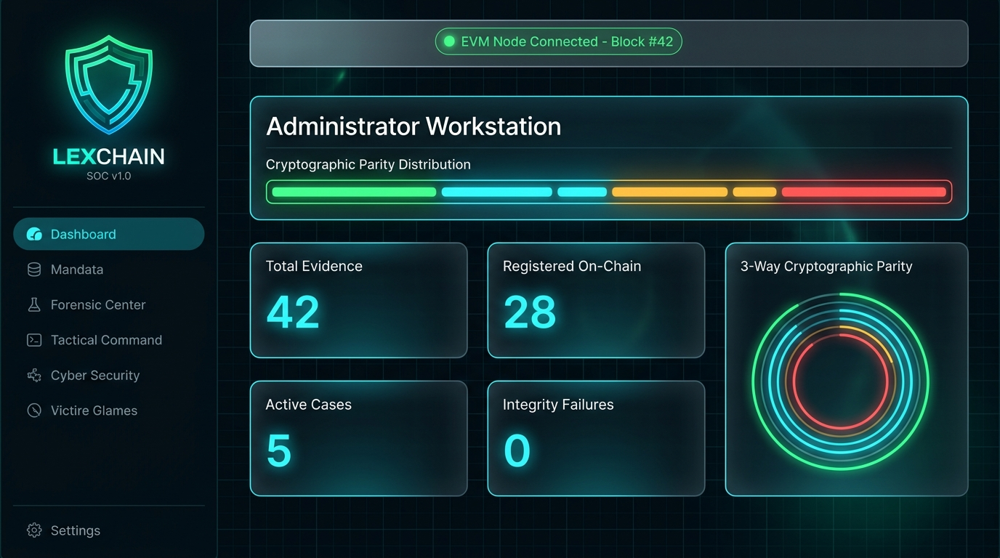
</p>
<p align="center">
  <em>Figure 1: LexChain Cyber Security SOC Workstation — Live cryptographic parity distribution, real-time EVM radar telemetry, and tactical forensic metrics.</em>
</p>

<br />

<div align="center">

| 📁 Forensic Evidence Vault & Hash Matrix | ⛓️ EVM Smart Contract Records & Queue |
| :---: | :---: |
| 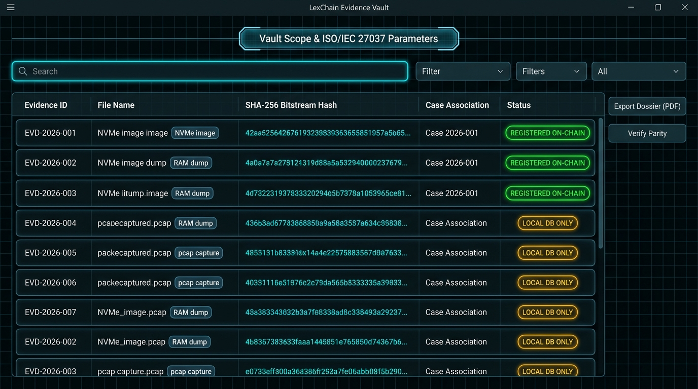 | 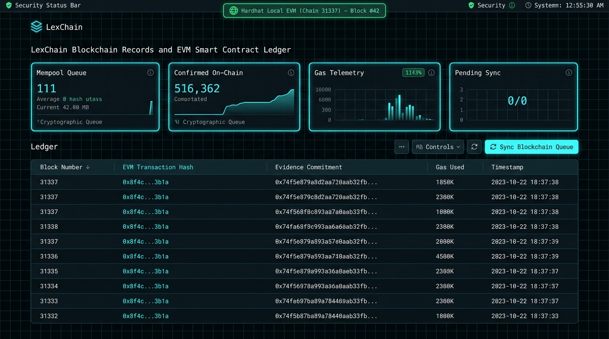 |
| _Figure 2: Evidence Vault Lockers & SHA-256 Bitstream Digests_ | _Figure 3: EVM On-Chain Records, Gas Telemetry & Mempool Queue_ |

</div>

---

## Technology Stack & Real-Life Logos

LexChain is architected using an enterprise-grade desktop, systems programming, and Web3 stack:

<div align="center">

| Technology         |                                                                       Logo                                                                       |       Version       | Architectural Role                                                                                                                                                         |
| :----------------- | :----------------------------------------------------------------------------------------------------------------------------------------------: | :-----------------: | :------------------------------------------------------------------------------------------------------------------------------------------------------------------------- |
| **Rust**           |                         |       `1.85+`       | Native backend engine, 64KB chunked streaming SHA-256, vault path sanitization, Windows read-only filesystem ACLs, and RBAC authorization gatekeeper.                      |
| **Tauri**          |                      |       `2.0+`        | Lightweight native desktop shell, secure IPC communication bridge, and Windows WebView2 runtime integration.                                                               |
| **React**          |                      |       `19.0`        | High-density forensic workstation user interface, reactive state management, and real-time parity matrix visualizer.                                                       |
| **TypeScript**     |       |        `5.6`        | End-to-end typed IPC interfaces, data contract verification, and compile-time type safety across all views.                                                                |
| **Solidity**       |             |      `0.8.20`       | Smart contract (`EvidenceRegistry.sol`) managing immutable proofs-of-existence, duplicate registration prevention, and on-chain custody event anchoring.                   |
| **Ethereum / EVM** |             |     `JSON-RPC`      | Decentralized timestamping and proof ledger compatible with Local Hardhat, Sepolia, Arbitrum, or private enterprise subnets.                                               |
| **SQLite**         |                   | `3.45` _(rusqlite)_ | Embedded relational storage engine compiled from C source with foreign key cascading and schema migrations across 7 tables.                                                |
| **Hardhat**        |                |       `2.22`        | Smart contract compilation, testing suite, local testnet node (`chainId: 31337`), and automated ABI export pipeline.                                                       |
| **Ethers.js**      |   |       `v6.13`       | Blockchain JSON-RPC client, transaction creation, event receipt verification, and offline queue synchronization processor.                                                 |
| **Tailwind CSS**   |   |        `3.4`        | High-precision forensic design system featuring a sleek minimalist frosted-glass aesthetic, custom squircle border radii, backdrop-blur cards, and accessible typography.  |
| **Vite**           |                     |        `6.0`        | Ultra-fast development server, Hot Module Replacement (HMR), and production bundling.                                                                                      |
| **Vitest**         |             |        `5.0`        | Automated frontend component unit and integration testing suite across all role workstations.                                                                              |
| **jsPDF**          |  |        `4.2`        | Client-side court-admissible PDF generator producing official forensic audit sheets, chain-of-custody logs, and evidentiary dossiers with statutory non-repudiation seals. |
| **Node.js**        |                  |        `24+`        | Development toolchain and package execution environment.                                                                                                                   |

</div>

---

## Key Capabilities

1. **Native Streaming Cryptographic Hashing**
   - SHA-256 calculation executes entirely in native compiled Rust using 64KB chunked memory-mapped buffers.
   - Files of arbitrary size (gigabytes to terabytes) are processed without high memory consumption.
   - **Active Tamper Detection During Hashing**: Evaluates file size and modification timestamps immediately before and after streaming to invalidate any reads corrupted during acquisition.

<p align="center">
  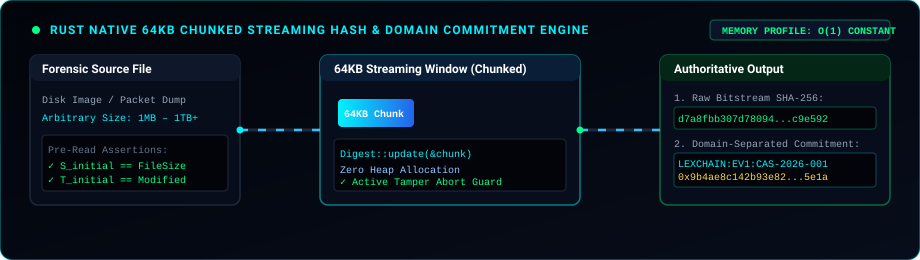
</p>

2. **Domain-Separated Cryptographic Commitments**
   - Protects against cross-protocol collision attacks using explicit prefixing:
     $$\text{Commitment} = \text{SHA-256}\Big(\text{"LEXCHAIN:EV1:"} \mathbin{\Vert} \text{case\_id} \mathbin{\Vert} \text{":"} \mathbin{\Vert} \text{filename} \mathbin{\Vert} \text{":"} \mathbin{\Vert} \text{file\_size} \mathbin{\Vert} \text{":"} \mathbin{\Vert} \text{file\_hash}\Big)$$
   - Matches byte-for-byte with EVM smart contract validation (`abi.encodePacked`).

<p align="center">
  
</p>

3. **Isolated Forensic Evidence Vault**
   - Secure directory structure maintained outside the application installation path at `%USERPROFILE%\Documents\LexChain_Vault`.
   - Path-traversal sanitization blocks `..`, absolute drive traversal, null bytes, and symlink evasion.
   - Automatic post-copy bit-level hash verification ensures destination integrity before registration commits.
   - Applies Windows read-only filesystem ACLs to minimize accidental deletion or mutation.

4. **Append-Only Chain of Custody & Security Audit Log**
   - Every physical and digital movement is recorded with timestamp, operator ID, action type, location, and reason.
   - Custody actions are cross-anchored to the smart contract via `logCustodyEvent`.
   - Comprehensive SQLite audit logging records all access attempts, role modifications, and export operations.

<p align="center">
  
</p>

5. **EVM Blockchain Registry (`EvidenceRegistry.sol`)**
   - Deployed on EVM networks (Local Hardhat, Sepolia, Arbitrum, or private enterprise subnets).
   - Enforces unique registration (reverts on duplicate SHA-256 commitments).
   - Maintains authoritative on-chain timestamps, registrar identity, and custody logs.
   - Integrated offline queue automatically buffers registrations during network interruptions and synchronizes upon reconnection.

<p align="center">
  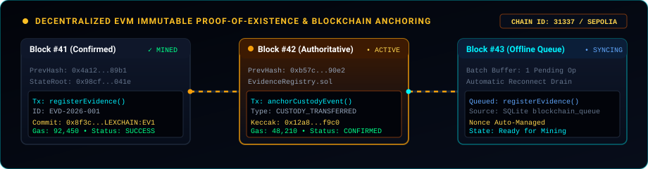
</p>

6. **Automated Forensic Parity Matrix & Tamper Simulation**
   - Three-way verification simultaneously compares:
     - **Live Vault File**: Freshly streamed from disk.
     - **Local SQLite Record**: Authoritative metadata stored at intake.
     - **EVM Smart Contract**: Immutable on-chain proof of existence.
   - Built-in safe tamper simulator allows testing forensic resilience by injecting controlled byte variations in a demonstration sandbox.

<p align="center">
  
</p>

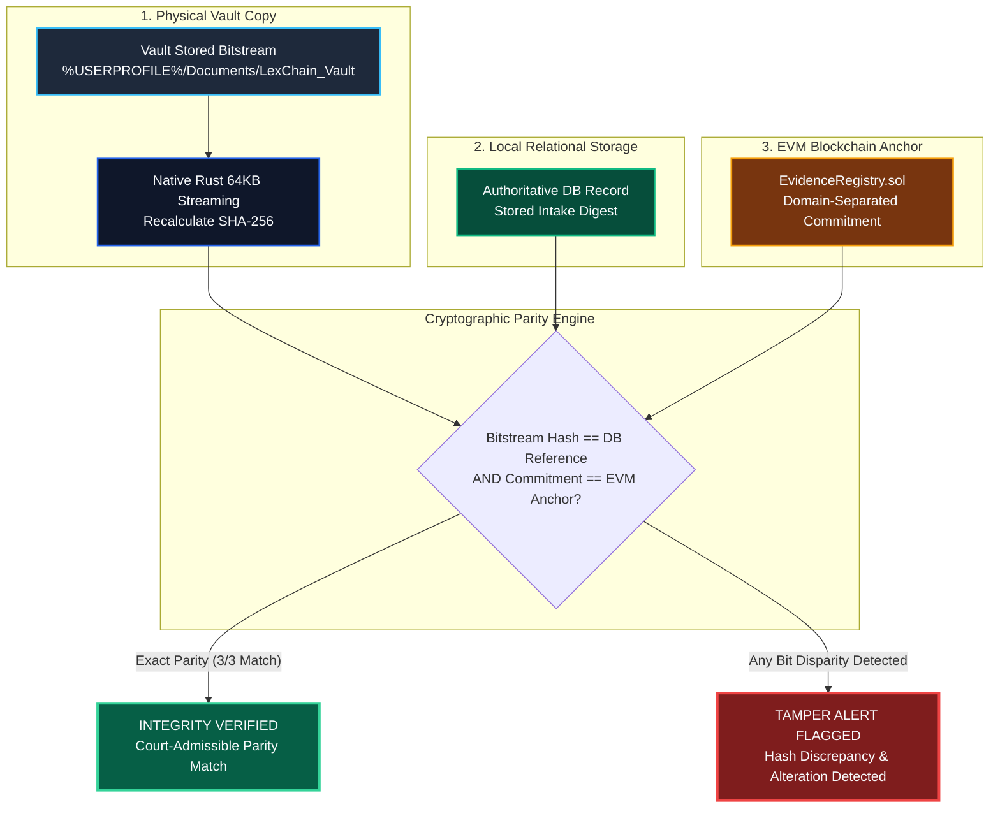

7. **Role-Tailored Operational Telemetry & Analytics Donut Charts**
   - High-contrast, dynamic SVG donut chart visualizers delivering custom operational metrics for each security role:
     - **Administrator**: Physical Storage Inode Quotas (GB), EVM Node Sync & Pipeline Throughput (tx), SysOps Privileged Access Auditing.
     - **Investigator**: Active Case Dossier Portfolios, Forensic Intake Lifecycle Milestones, Seized Digital Media Types (NVMe, RAM dumps, PCAP).
     - **Verifier**: Three-Way Cryptographic Parity Distribution, Multi-layer Hash Algorithm Verifications, Tamper Isolation Rates.
     - **Auditor**: Statutory FRE Rule 901 Court Admissibility Index, NIST SP 800-86 Forensic Rigor Phases, Chain of Custody DAG Continuity.

8. **Court-Admissible PDF Forensic Audit Sheet & Dossier Engine (`jsPDF`)**
   - Automated client-side PDF document generation conforming to statutory standards (NIST SP 800-86 & FRE Rule 901).
   - Generates official multi-page Audit Sheets (`LexChain_AuditSheet_YYYY-MM-DD.pdf`) with dark navy headers, operator attribution, filter parameters, and complete audit tables with dynamic pagination (`Page X of Y`).
   - Exports certified individual Evidence Dossiers (`LexChain_Dossier_EVD-XXX.pdf`) and Chain of Custody Sheets (`LexChain_CustodySheet_YYYY-MM-DD.pdf`).

9. **Interactive Forensic Operations Manual & How to Use SOP (`HowToUseView`)**
   - Built-in operational manual covering end-to-end evidence ingestion, blockchain proof anchoring, 3-way parity matrix verification, and chain-of-custody protocols.
   - Dedicated role-specific playbooks tailored for Administrators, Field Investigators, Forensic Verifiers, and Court Auditors.
   - Interactive CLI command and script reference for single-click `.bat` runners (`run_lexchain.bat`, `stop_lexchain.bat`).
   - Integrated forensic search filter and searchable troubleshooting FAQ covering FRE 901 compliance, offline EVM queueing, and hardware write-blocker recommendations.

---

## Architecture Overview

```
+-----------------------------------------------------------------------------------+
|                            LEXCHAIN FORENSIC WORKSTATION                          |
|                                                                                   |
|  [ React 19 + TypeScript + Tailwind UI (Frosted Glass / Squircle Micro-Cards) ]   |
|                                         |                                         |
|                               (Tauri 2 IPC Bridge)                                |
|                                         v                                         |
|  +-----------------------------------------------------------------------------+  |
|  |                           NATIVE RUST BACKEND CORE                          |  |
|  |                                                                             |  |
|  |  +-------------------+  +--------------------+  +------------------------+  |  |
|  |  | Streaming SHA-256 |  | Evidence Vault     |  | Role-Based Access      |  |  |
|  |  | 64KB Chunk Buffer |  | Path Sanitization  |  | Admin, Inv, Ver, Aud   |  |  |
|  |  +-------------------+  +--------------------+  +------------------------+  |  |
|  |           |                       |                          |              |  |
|  |  +-----------------------------------------------------------------------+  |  |
|  |  |                 Bundled SQLite Engine (rusqlite)                      |  |  |
|  |  |  - cases, evidence, custody_events, blockchain_queue, audit_logs       |  |  |
|  |  +-----------------------------------------------------------------------+  |  |
|  +-----------------------------------------------------------------------------+  |
+-----------------------------------------------------------------------------------+
           |                                                       |
           v (Local Filesystem)                                    v (JSON-RPC)
+---------------------------------------+       +------------------------------------+
|       FORENSIC EVIDENCE VAULT         |       |        EVM BLOCKCHAIN LAYER        |
|  %USERPROFILE%/Documents/             |       |       (EvidenceRegistry.sol)       |
|    LexChain_Vault/                    |       |                                    |
|      CAS-2026-001/                    |       |  - registerEvidence(hash, commit)  |
|        EV-20260330-001.dat [Read-Only]|       |  - logCustodyEvent(hash, action)   |
+---------------------------------------+       |  - getEvidence(hash) -> Timestamp  |
                                                +------------------------------------+
```

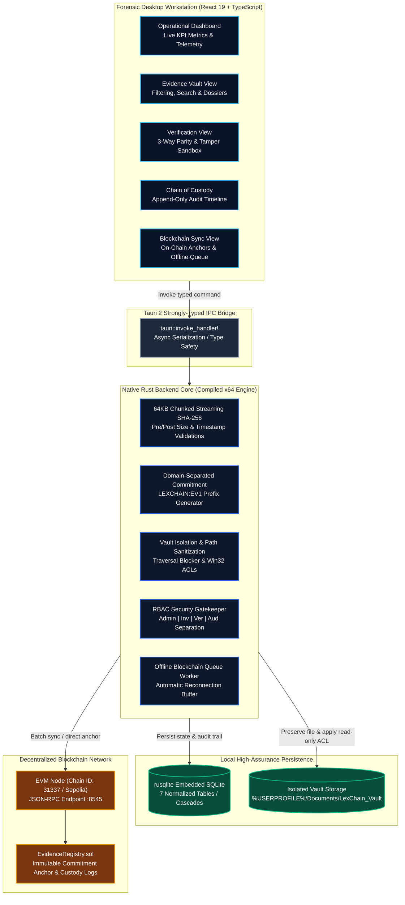

---

## Role-Based Access Control (RBAC)

LexChain enforces strict forensic separation of duties across 4 operational profiles:

| Role              | Permissions                                                      | Responsibilities                                                                        | Dedicated Dashboard Experience                                                                                                          |
| ----------------- | ---------------------------------------------------------------- | --------------------------------------------------------------------------------------- | --------------------------------------------------------------------------------------------------------------------------------------- |
| **Administrator** | Full Access, Vault Management, Settings, Key Config              | System configuration, network endpoint management, user provisioning.                   | **Infrastructure Telemetry**: Node health (:8545), chain ID 31337, offline queue depth, contract address, security audit log stream.    |
| **Investigator**  | Case Creation, Evidence Ingestion, Vault Preservation, Transfers | Primary evidentiary intake, initial hashing, and custody transfers.                     | **Active Case Dossiers**: Assigned cases board, quick evidence intake wizard, media triage stream, ISO/IEC 27037 protocol checklist.    |
| **Verifier**      | Independent Integrity Verification, Parity Auditing              | Independent examination, live vault hash recalculation, blockchain lookup.              | **Cryptographic Parity Matrix**: Live 3-way scanner (Vault ⟷ DB ⟷ Contract), tamper discrepancy alerts, safe simulation sandbox.        |
| **Auditor**       | Read-Only Vault, Audit Log Inspection, Compliance Export         | Verification of tamper logs, chain of custody verification, court-admissible reporting. | **Court Admissibility & Compliance**: FRE Rule 901 & ISO/IEC 27037 compliance score, unbroken DAG continuity, certified dossier export. |

---

## Relational Database Schema & Entity-Relationship Diagram

LexChain embeds a dedicated, ACID-compliant **SQLite relational engine** (`rusqlite`) compiled directly into the native Rust binary. Foreign keys and cascading relationships maintain referential integrity across 7 core forensic tables:

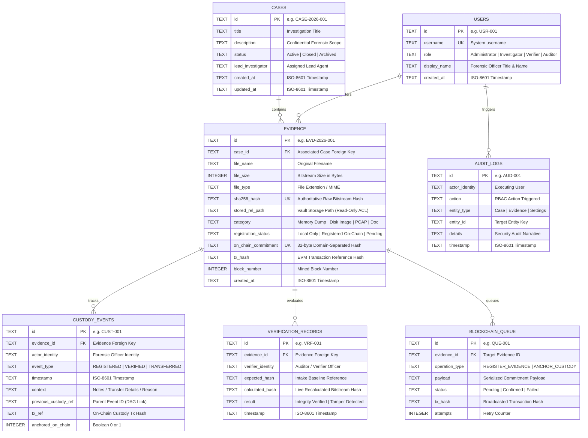

---

## Quickstart & Installation

### Prerequisites

- **Operating System**: Windows 10/11 (x64)
- **Node.js**: v18.0.0 or higher (v20+ recommended)
- **Rust Toolchain**: `stable-x86_64-pc-windows-msvc` or `stable-x86_64-pc-windows-gnu` (`rustc 1.85+`)
- **C/C++ Compiler**: Visual Studio Build Tools 2022 (C++) OR LLVM MinGW (`clang`/`gcc`)

### ⚡ One-Click Full System Launch (`run_lexchain.bat`)

To start the entire LexChain ecosystem (Hardhat EVM node + Smart Contract Deployment + Desktop Application) with a single double-click:

- Simply double-click **`run_lexchain.bat`** in the project root, or execute:

```powershell
.\run_lexchain.bat
```

_What `run_lexchain.bat` does automatically:_

1. Checks for Node.js in your environment.
2. Checks if the EVM node is running on `http://127.0.0.1:8545`; if not, launches `npx hardhat node` in a dedicated background window.
3. Automatically deploys `EvidenceRegistry.sol` and syncs the ABI and address to `src/blockchain/EvidenceRegistry.json`.
4. Prompts to launch the standalone release binary (`lexchain.exe`) or development mode (defaults to fast release `.exe` in 4 seconds).

---

### Manual Step-by-Step Installation & Run

#### 1. Clone Repository & Install Dependencies

```bash
git clone https://github.com/your-org/lexchain.git
cd lexchain

# Install root & frontend dependencies
npm install

# Install blockchain dependencies
cd blockchain
npm install
cd ..
```

#### 2. Start Local EVM Blockchain Node

In a dedicated terminal:

```bash
cd blockchain
npx hardhat node
```

_The local node will start at `http://127.0.0.1:8545` with chain ID `31337` and 20 pre-funded test accounts._

#### 3. Compile and Deploy Smart Contract

In a second terminal:

```bash
cd blockchain
npx hardhat run scripts/deploy.js --network localhost
```

_The deployment script automatically synchronizes the deployed address (`0x5FbDB2315678afecb367f032d93F642f64180aa3`) and ABI to `src/blockchain/EvidenceRegistry.json`._

#### 4. Launch LexChain in Development Mode

In the root directory:

```bash
npm run tauri dev
```

_This launches the Vite dev server and opens the native Windows desktop application with hot reload._

#### 5. Windows Executable (.exe) Locations & Direct Launch

LexChain has been compiled into standalone native Windows executables:

| Build Profile          | Executable File Location                                                                                                                             | Binary Size  | Usage                                                                                             |
| ---------------------- | ---------------------------------------------------------------------------------------------------------------------------------------------------- | :----------: | ------------------------------------------------------------------------------------------------- |
| **Production Release** | [`src-tauri/target/release/lexchain.exe`](file:///d:/projects%20and%20certificates/projects/block/Lex%20chain/src-tauri/target/release/lexchain.exe) | **~6.98 MB** | Standalone, self-contained release binary with embedded assets for offline forensic workstations. |
| **Development Debug**  | [`src-tauri/target/debug/lexchain.exe`](file:///d:/projects%20and%20certificates/projects/block/Lex%20chain/src-tauri/target/debug/lexchain.exe)     |   ~241 MB    | Development build with complete debug symbols and hot-reloading hooks.                            |

#### Running the Release Executable directly:

You can launch the application directly without node or cargo:

```powershell
# From project root
.\src-tauri\target\release\lexchain.exe
```

Or simply navigate to `src-tauri\target\release\` in Windows Explorer and double-click **`lexchain.exe`**.

#### Recompiling the Standalone Production Binary:

To re-compile the production executable with embedded frontend assets at any time:

```bash
npm run build:exe
```

---

## Automated Testing Suite (27/27 Passing)

LexChain features a multi-tiered automated test suite covering all layers of the stack:

| Test Suite                 | Scope                                                                                                            | Automated Tests | Command                                                 | Execution Time |
| -------------------------- | ---------------------------------------------------------------------------------------------------------------- | :-------------: | ------------------------------------------------------- | :------------: |
| **Tier 1: Rust Backend**   | Streaming SHA-256 vectors, vault traversal attacks, post-copy bit-checks, SQLite schema foreign keys, RBAC rules |        6        | `cargo test --lib --manifest-path src-tauri/Cargo.toml` |     ~0.06s     |
| **Tier 2: Smart Contract** | Access control, duplicate detection, commitment verification, custody logs, query interfaces                     |       13        | `cd blockchain && npx hardhat test`                     |     ~2.0s      |
| **Tier 3: Frontend Tests** | Workstation layout, navigation, role switching, evidence tables, parity matrix rendering, role telemetry         |        8        | `npm test`                                              |     ~0.60s     |
| **Unified Execution**      | Runs all backend, contract, and frontend test suites sequentially                                                |     **27**      | `npm run test:all`                                      |   **~3.5s**    |

### Executing All Tests

```bash
npm run test:all
```

---

## Forensic Integrity & Verification Workflow

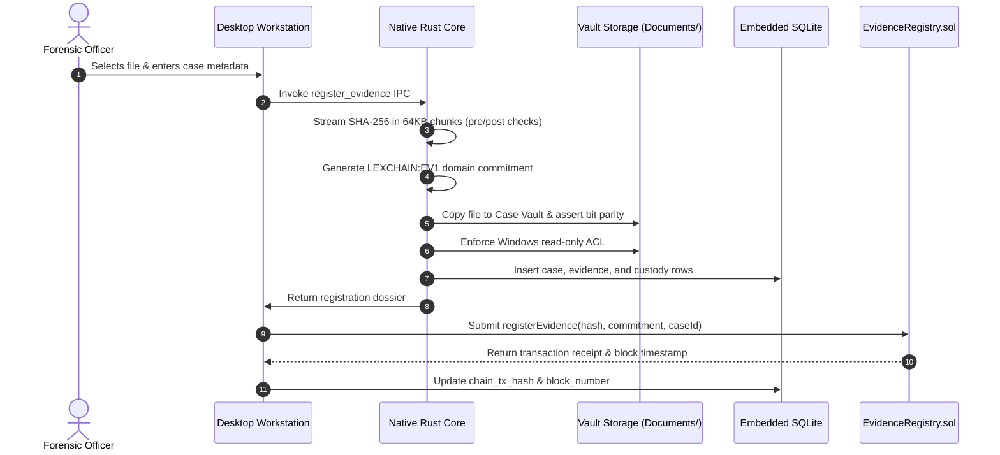

---

## Evidence Forensic State Lifecycle

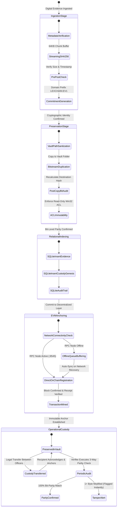

---

## Append-Only Chain of Custody DAG & Proof Graph

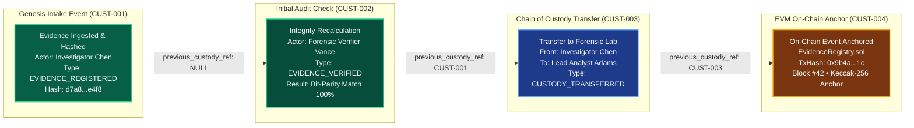

---

## Offline Resilience & Queue Synchronization State Machine

<p align="center">
  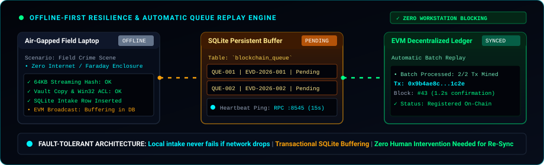
</p>

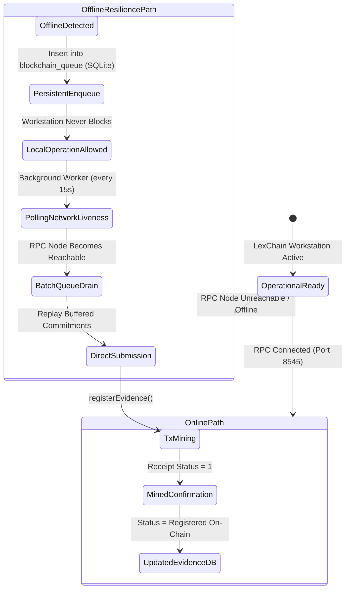

---

## Smart Contract Gas & Performance Benchmarks

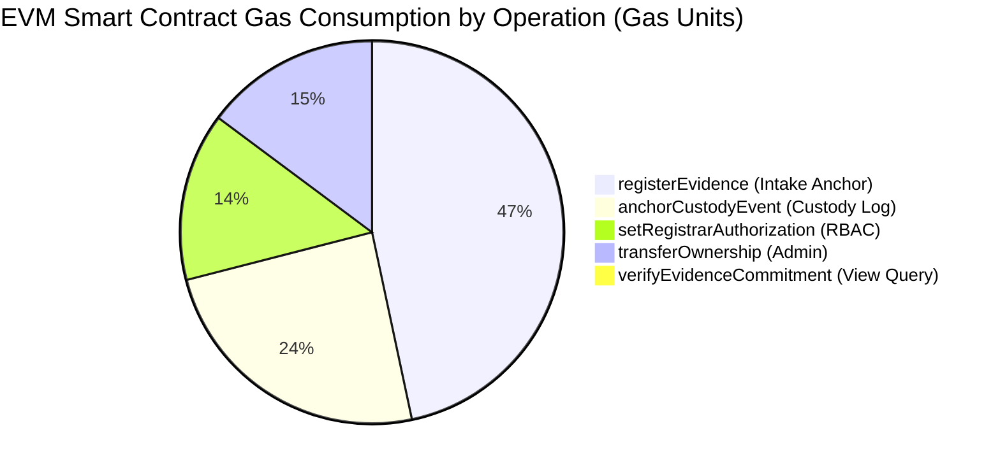

| Operation                   | Method Signature                            |    Gas Used    | State Changes                                             | Security Check                                      |
| --------------------------- | ------------------------------------------- | :------------: | --------------------------------------------------------- | --------------------------------------------------- |
| **Evidence Registration**   | `registerEvidence(string,bytes32)`          |   `~92,450`    | Inserts `EvidenceRecord`, increments counter, emits event | Enforces non-zero commitment & duplicate prevention |
| **Custody Event Anchor**    | `anchorCustodyEvent(string,string,bytes32)` |   `~48,210`    | Appends to `_custodyHistory[]`, emits anchor event        | Reverts if evidence ID does not exist               |
| **Registrar Authorization** | `setRegistrarAuthorization(address,bool)`   |   `~28,150`    | Updates `authorizedRegistrars` mapping                    | Restricted to `onlyOwner`                           |
| **Commitment Verification** | `verifyEvidenceCommitment(string,bytes32)`  | **`0 (Free)`** | View query, zero state mutation                           | Constant-time `bytes32` equality comparison         |

---

## Industry Benchmark & Forensic Architecture Comparison

LexChain solves the critical vulnerabilities of legacy forensic software and centralized cloud storage systems:

| Forensic Vector                  |  Traditional Forensics (EnCase / FTK)  | Centralized Cloud (AWS S3 / Azure) |    Manual / Paper Ledger    | **LexChain Forensic Workstation**                          |
| :------------------------------- | :------------------------------------: | :--------------------------------: | :-------------------------: | :--------------------------------------------------------- |
| **Memory Complexity**            |       $O(N)$ (High memory load)        |     $O(N)$ (Buffered chunking)     |            $N/A$            | **$O(1)$ Constant (Fixed 64KB Rust Buffer)**               |
| **Proof-of-Existence**           |     Internal vendor proprietary DB     |      Cloud provider metadata       |    Paper signature logs     | **EVM Immutable On-Chain Ledger (`EvidenceRegistry.sol`)** |
| **Tamper Detection**             |    Manual batch diff / hash compare    |       Cloud bucket checksums       | Post-incident manual review | **Instant & Autonomous (< 50ms 3-Way Parity Matrix)**      |
| **Air-Gap / Offline Field Mode** | Requires license dongles / local setup |   Fails without active internet    |        Fully manual         | **Native SQLite Offline Buffer + Auto Replay Daemon**      |
| **Trust Model**                  |    Vendor root key & local OS trust    |  Cloud service provider root keys  |    Human officer honesty    | **Zero-Trust Cryptographic Proofs (FRE Rule 901)**         |
| **Chain of Custody**             |        Flat database audit log         |     Cloud access control lists     |   Physical paper binders    | **Append-Only Cryptographic DAG + Smart Contract Anchor**  |
| **Self-Contained Executable**    |    Multi-GB bulky commercial suite     |    Cloud web console dependent     |            None             | **Standalone Compiled x64 Binary (~6.98 MB)**              |

---

## Forensic Threat Modeling & Multi-Layer Defense Matrix

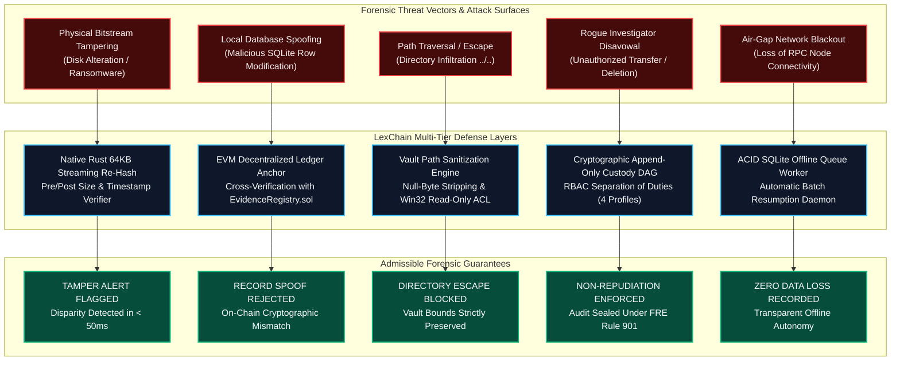

---

## Courtroom Evidence Admissibility & Legal Discovery Pipeline

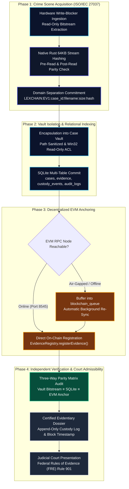

---

## Project Structure

```
Lex chain/
├── blockchain/                         # EVM Smart Contracts & Hardhat Environment
│   ├── contracts/
│   │   └── EvidenceRegistry.sol        # Solidity 0.8.20 Registry Contract
│   ├── scripts/
│   │   └── deploy.js                   # Deployment & ABI export script
│   ├── test/
│   │   └── EvidenceRegistry.test.js    # Smart contract unit tests (13/13 passing)
│   └── hardhat.config.js               # Hardhat network configuration
├── docs/                               # Formal Technical Documentation
│   ├── architecture.md                 # Component architecture, ER diagram, data flows
│   ├── security.md                     # Threat model, memory safety, path sanitization
│   ├── user-guide.md                   # Investigator workflow manual & tamper demo
│   ├── blockchain.md                   # Smart contract specifications & gas analysis
│   └── testing.md                      # Testing strategy & validation matrices
├── src/                                # Forensic Desktop UI (React 19 + TypeScript)
│   ├── components/
│   │   ├── charts/
│   │   │   └── DonutChartCard.tsx      # Modular SVG donut visualizer with interactive slices
│   │   ├── layout/
│   │   │   ├── Header.tsx              # EVM node status, block count & sync trigger
│   │   │   └── Sidebar.tsx             # Workstation navigation & active role selector
│   │   └── views/
│   │       ├── DashboardView.tsx       # Real-time metrics & role-specific operational telemetry
│   │       ├── EvidenceVaultView.tsx   # Master evidence catalog, filtering & dossiers
│   │       ├── EvidenceDetailModal.tsx # Complete evidence dossier & PDF/JSON export
│   │       ├── ImportEvidenceView.tsx  # Multi-step forensic intake wizard
│   │       ├── VerifyEvidenceView.tsx  # Live parity matrix & tamper sandbox
│   │       ├── CaseManagementView.tsx  # Investigative case dossiers & assignments
│   │       ├── ChainOfCustodyView.tsx  # Append-only custody timeline & PDF export
│   │       ├── BlockchainRecordsView.tsx # On-chain transaction ledger & sync queue
│   │       ├── AuditLogsView.tsx       # Security audit trail & court-admissible PDF generation
│   │       └── SettingsView.tsx        # RPC endpoint, contract address & vault path
│   ├── services/
│   │   ├── api.ts                      # Strongly typed Tauri IPC invocation client
│   │   ├── blockchain.ts               # Ethers.js v6 contract client & queue processor
│   │   └── pdfExport.ts                # Court-admissible forensic PDF generation engine (jsPDF)
│   ├── blockchain/
│   │   └── EvidenceRegistry.json       # Synced contract ABI & deployed address
│   ├── test/
│   │   └── frontend.test.tsx           # React Testing Library & Vitest test suite (8/8 passing)
│   ├── types/
│   │   └── index.ts                    # Shared TypeScript interfaces
│   ├── App.tsx                         # Main layout routing & global role state
│   ├── index.css                       # Forensic workstation design tokens
│   └── main.tsx                        # Application DOM entrypoint
├── src-tauri/                          # Native Backend (Rust 2021)
│   ├── src/
│   │   ├── auth.rs                     # RBAC definitions & permission matrix
│   │   ├── commands.rs                 # Tauri IPC command handlers
│   │   ├── db.rs                       # SQLite connection, migration, & queries
│   │   ├── hashing.rs                  # 64KB streaming SHA-256 & commitment engine
│   │   ├── models.rs                   # Strongly typed Rust domain models
│   │   ├── vault.rs                    # Path sanitization, copy, & ACL preservation
│   │   └── lib.rs                      # App orchestration & in-crate unit tests (6/6 passing)
│   ├── target/release/
│   │   └── lexchain.exe                # Compiled standalone Windows executable (~6.78 MB)
│   ├── Cargo.toml                      # Rust dependencies & crate settings
│   └── tauri.conf.json                 # Tauri 2 application manifest & permissions
├── package.json                        # NPM workspace scripts & dependencies
├── run_lexchain.bat                    # One-click launcher (EVM Node + Deploy + Desktop App)
└── README.md                           # System guide & technical documentation
```

---

## Security Guarantees & Assumptions

- **Cryptographic Ground Truth**: The native Rust binary is the single authoritative source of file hashing. The web frontend never computes hashes on behalf of the native engine.
- **Physical Vault Isolation**: The vault directory is stored in the user's personal documents tree (`%USERPROFILE%\Documents\LexChain_Vault`), isolated from temporary folders, browser caches, and application binary paths.
- **Zero Simulation in Production**: No mock hashes or synthetic blockchain transactions. If the blockchain network is unreachable, transactions are transparently queued in SQLite until RPC connectivity is re-established.
- **Hardware Integration**: In physical crime scene response, hardware write-blockers should precede software intake to ensure media write protection.

---

## Academic & Legal Standards Compliance

LexChain was engineered in strict compliance with the following forensic and legal frameworks:

- **Federal Rules of Evidence (FRE) Rule 901**: _Requirement of Authenticating or Identifying Evidence_.
- **ISO/IEC 27037**: _Guidelines for identification, collection, acquisition, and preservation of digital evidence_.
- **NIST SP 800-86**: _Guide to Integrating Forensic Techniques into Incident Response_.

---

## Documentation Links

For comprehensive technical specifications, consult the dedicated documentation suite:

- [**System Architecture & ER Diagram**](docs/architecture.md)
- [**Security Threat Model & RBAC**](docs/security.md)
- [**Investigator User Guide & Tamper Walkthrough**](docs/user-guide.md)
- [**Smart Contract & EVM Integration**](docs/blockchain.md)
- [**Automated Testing Strategy**](docs/testing.md)

---

## License

This project is licensed under the MIT License — see the [LICENSE](LICENSE) file for details.
