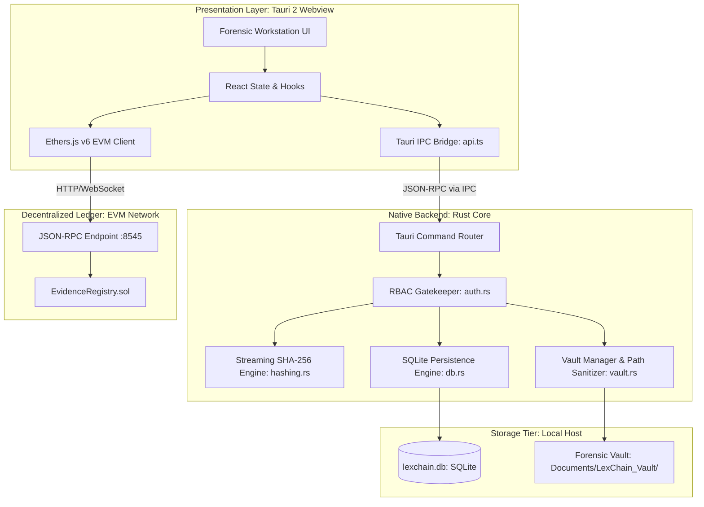
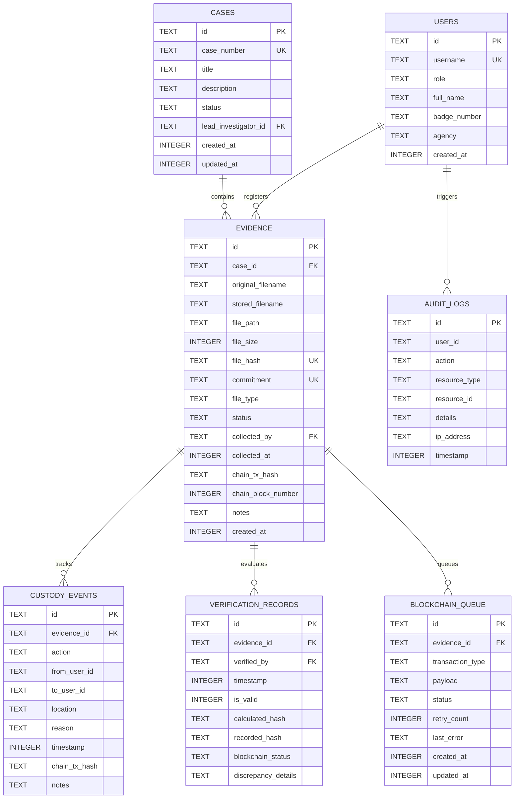

# LexChain: System Architecture Specification

## 1. Executive Summary

LexChain is a local-first, forensic-grade digital evidence management and integrity verification system. The architecture is intentionally decoupled into three distinct tiers:
1. **Presentation & Workstation Layer**: High-density React 19 + TypeScript desktop interface running within a Tauri 2 WebView2 container.
2. **Authoritative Execution & Storage Layer**: Native compiled Rust backend that handles file I/O, 64KB chunked cryptographic hashing, path sanitization, Windows filesystem ACLs, and embedded SQLite data storage via `rusqlite`.
3. **Decentralized Verification & Timestamping Layer**: EVM smart contract (`EvidenceRegistry.sol`) acting as an immutable public ledger for proof-of-existence, domain-separated cryptographic commitments, and on-chain custody audit logs.

---

## 2. Component Architecture



---

## 3. Cryptographic Primitives & Integrity Engine

### 3.1 Streaming SHA-256 Hashing (`src-tauri/src/hashing.rs`)
To eliminate out-of-memory errors and handle forensic disk images or multimedia files spanning hundreds of gigabytes, LexChain computes SHA-256 hashes via a constant-memory streaming pipeline:
- **Buffer Size**: 64 KB (65,536 bytes).
- **Algorithm**: NIST FIPS 180-4 SHA-256 via Rust's `sha2::Sha256`.
- **Pre- and Post-Read Concurrency Assertion**:
  Before opening the file handle, the engine records:
  $$S_{\text{initial}} = \text{FileSize}, \quad T_{\text{initial}} = \text{ModifiedTimestamp}$$
  Upon exhausting the stream, the engine re-queries metadata:
  $$S_{\text{final}} = \text{FileSize}, \quad T_{\text{final}} = \text{ModifiedTimestamp}$$
  If $S_{\text{initial}} \neq S_{\text{final}}$ or $T_{\text{initial}} \neq T_{\text{final}}$, the read is flagged as concurrent tampering, aborted immediately, and an integrity violation error is returned.

### 3.2 Domain-Separated Cryptographic Commitment
To bind evidentiary metadata inextricably to the underlying bitstream and prevent cross-context replay attacks, LexChain calculates a domain-separated commitment:
$$\text{Commitment} = \text{SHA-256}\Big(\text{"LEXCHAIN:EV1:"} \mathbin{\Vert} \text{case\_id} \mathbin{\Vert} \text{":"} \mathbin{\Vert} \text{original\_filename} \mathbin{\Vert} \text{":"} \mathbin{\Vert} \text{file\_size} \mathbin{\Vert} \text{":"} \mathbin{\Vert} \text{file\_hash\_hex}\Big)$$

This string is computed identically in both:
- **Native Rust**: `generate_evidence_commitment()` in `src-tauri/src/hashing.rs`.
- **EVM Solidity**: Validated via `keccak256(abi.encodePacked(...))` or stored as authoritative `bytes32`.

---

## 4. Controlled Evidence Vault (`src-tauri/src/vault.rs`)

### 4.1 Storage Isolation
Evidence files are **never** stored within the application directory, browser cache, or temporary folders. The vault is provisioned in the user's permanent document root:
$$\text{Vault Root} = \verb|%USERPROFILE%\Documents\LexChain_Vault|$$

### 4.2 Path Traversal & Injection Defense
All relative path segments (`case_id`, `evidence_id`, `filename`) undergo strict sanitization:
- Forbidden path separators (`/`, `\`, null bytes, control characters) are stripped.
- Directory traversal tokens (`..`, `.`) are rejected.
- Target paths are canonicalized and verified to start with the authoritative vault root path before any write operation is permitted.

### 4.3 Post-Copy Verification & Read-Only ACL
1. The file is copied from source to the case subfolder: `%USERPROFILE%\Documents\LexChain_Vault\<case_id>\<evidence_id>.<ext>`.
2. A fresh streaming SHA-256 hash is computed on the copied file in the vault.
3. If $\text{Hash}_{\text{vault}} \neq \text{Hash}_{\text{source}}$, the target file is securely erased and an error is raised.
4. On Windows, read-only permissions are enforced on the resulting file to prevent accidental OS-level deletion or mutation.

---

## 5. Local Database Schema & ER Diagram

The embedded SQLite database (`rusqlite`) enforces foreign keys, unique constraints, and append-only audit histories.



---

## 6. Smart Contract Architecture (`EvidenceRegistry.sol`)

The Solidity 0.8.20 contract maintains authoritative on-chain state for evidence verification and custody audit trails.

### Key Data Structures:
```solidity
struct EvidenceRecord {
    bytes32 fileHash;        // SHA-256 hash of the evidence file
    bytes32 commitment;      // Domain-separated commitment hash
    string caseId;           // Associated case identifier
    string metadataUri;      // Off-chain URI or hash reference
    address registeredBy;    // Ethereum address of registrar
    uint256 registeredAt;    // Authoritative block timestamp
    bool exists;             // Existence guard
}

struct CustodyEvent {
    bytes32 evidenceHash;    // Reference to evidence
    string action;           // TRANSFER, AUDIT, ANALYSIS, COURT_PRODUCTION
    string actor;            // Badge number or agent identifier
    string toActor;          // Receiving agent identifier
    string location;         // Physical or logical destination
    uint256 timestamp;       // Block timestamp
}
```

### Invariants & Security Enforcements:
- **Duplicate Prevention**: `registerEvidence()` verifies `!records[fileHash].exists`. Any attempt to register an already known SHA-256 hash reverts with `EvidenceAlreadyExists()`.
- **Append-Only Custody**: `logCustodyEvent()` appends to an array associated with `evidenceHash`. Records can never be updated, overwritten, or pruned.
- **Registrar Authorization**: Admin accounts can grant or revoke `REGISTRAR_ROLE` permissions to manage transacting field agents.

---

## 7. Forensic Verification Parity Matrix

When a verification audit is executed, LexChain checks three independent records simultaneously:

| Check Component | Source 1 | Source 2 | Forensic Significance |
|---|---|---|---|
| **Local File Integrity** | Live Vault File Hash | Local SQLite `file_hash` | Proves the physical file on the storage drive has not been tampered with or corrupted since acquisition. |
| **Local Database Integrity** | Local SQLite `file_hash` | Smart Contract `fileHash` | Proves the local database records have not been maliciously edited or forged by a rogue system administrator. |
| **End-to-End Authenticity** | Live Vault File Hash | Smart Contract `fileHash` | Proves mathematically that the exact bytes examined in court match the record sealed on the blockchain at the moment of intake. |

Any discrepancy in any of the three vectors results in an immediate red **TAMPERED / INTEGRITY VIOLATION** status with exact byte mismatch diagnostics.
